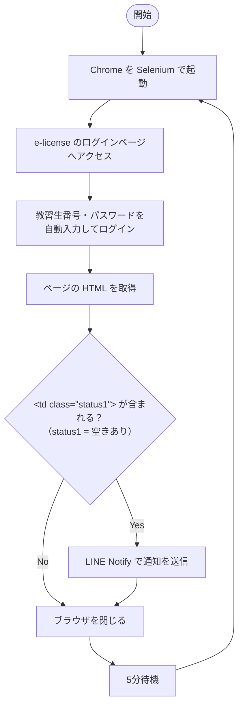
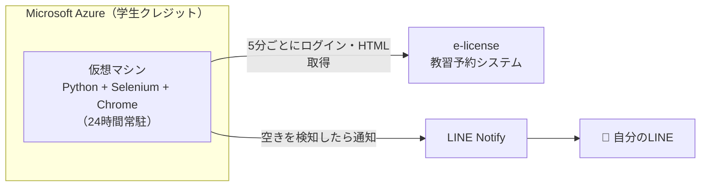

# 🚗 e-license 予約空き自動通知システム

> **English summary:** A Python bot that logs in to the "e-license" driving-school reservation system every 5 minutes on an Azure VM and sends a LINE notification when a lesson slot opens up.

**自動車学校の教習予約の「キャンセル待ち」を自動化し、空きが出たらLINEに通知する個人開発ツールです。**
手作業で1分おきに予約ページを確認していた手間をなくし、結果として約1か月での教習修了（早期卒業）につながりました。


> [!WARNING]
> **LINE Notify は 2025年3月にサービスを終了しました。**
> そのため、現在のコードのままでは**通知部分が動作しません**。利用する場合は、通知処理（`send_line_notify` 関数）を LINE Messaging API や Discord Webhook などに置き換える必要があります（[今後の改善](#-既知の課題と今後の改善) を参照）。

---

## 📑 目次

- [Why — なぜ作ったか](#-why--なぜ作ったか)
- [成果](#-成果)
- [仕組み](#-仕組み)
- [アーキテクチャ](#-アーキテクチャ)
- [技術スタックと選定理由](#-技術スタックと選定理由)
- [セットアップ・使い方](#-セットアップ使い方)
- [苦労した点](#-苦労した点)
- [既知の課題と今後の改善](#-既知の課題と今後の改善)
- [免責事項](#-免責事項)
- [作者](#-作者)

---

## 💡 Why — なぜ作ったか

2024年2月〜3月、私はNECの教習予約システム **「e-license」** を使う自動車学校に通っていました。

長期休暇の時期で教習生が多く、技能教習の予約はほぼ埋まっている状態。空きを取るには **キャンセル待ち** しかありませんでした。
少しでも早く卒業したかった私は、送迎バスの中や待ち時間に **1分おきに予約ページを手動で確認** していましたが、これが非常に手間でした。

> 「人間が張り付いて見続けるより、プログラムに見張らせればいい」

そう考えて、予約の空きを自動で検知して通知してくれる仕組みを作りました。

## 🏆 成果

- **稼働開始から約1か月で教習を修了し、早期卒業を達成。** 教習指導員の方にも驚かれ、称賛していただきました。
- **卒業後、教習所側のシステム担当者の方から連絡をいただき**、オンラインミーティングで実装内容についてヒアリングを受けました。その際「今後、仕事として何かお願いするかもしれない」とのお話もいただきました。

## ⚙️ 仕組み

Azure の仮想マシン上で Python スクリプトを常駐させ、次の処理を **5分ごと** に繰り返します。



1. Selenium で Chrome を起動し、e-license のログインページにアクセス
2. 教習生番号とパスワードを自動入力してログイン
3. 予約ページの HTML を取得し、空き枠を表す `<td class="status1">` が含まれているかを判定
4. 空きがあれば LINE Notify でスマートフォンに通知（メッセージに予約ページのURLを入れておけば、通知からすぐにアクセス可能）
5. ブラウザを閉じて5分待機し、1に戻る

## 🏗 アーキテクチャ



## 🧰 技術スタックと選定理由

構成は「自分がやりたいように」自分で考えて選びました。

| 技術 | 用途 | 選定理由 |
| --- | --- | --- |
| **Python** | スクリプト本体 | — |
| **Selenium** / chromedriver | ブラウザ操作（ログイン・HTML取得） | ログインが必要な予約ページを自動で操作するため |
| **requests** | LINE Notify API の呼び出し | HTTP POST でシンプルに通知を送れるため |
| **time** | 待機処理（5分間隔など） | — |
| **Microsoft Azure（仮想マシン）** | 実行環境 | 学生クレジットを活用し、自分のPCをつけっぱなしにせず24時間稼働させるため |
| **LINE Notify** | 通知 | 普段から使っているLINEなら通知に気づきやすいため |

## 🚀 セットアップ・使い方

> 卒業済みのため、現在の e-license で動作するかは保証できません。また前述のとおり LINE Notify は終了しているため、通知部分は置き換えが必要です。

### 必要なもの

- Python が動作する環境（自分のPC、またはクラウドの仮想マシン）
- Google Chrome
- 通知用のトークン（元の実装では LINE Notify のアクセストークン）

### 1. ライブラリのインストール

```bash
pip install selenium
pip install chromedriver-binary
pip install requests
pip install webdriver-manager   # コード内で ChromeDriverManager を使用しています
```

### 2. コード内の値を書き換える

`予約空き確認システム 完成版（公開版）.py` の以下の箇所を、自分の情報に置き換えてください。

| 箇所 | 書き換える内容 |
| --- | --- |
| `line_notify_token = '...'` | 通知用トークン |
| `driver.get('...')` | 通っている教習所の e-license ログインページURL |
| `send_keys('教習生番号を入れてね')` | 教習生番号 |
| `send_keys('パスワードを入れてね')` | パスワード |
| `send_line_notify("...")` のメッセージ | 予約ページのURLを入れておくと、通知からすぐアクセスできます |

> [!CAUTION]
> 教習生番号・パスワード・トークンをコードに直接書いた状態で、公開リポジトリに push しないよう注意してください。

### 3. 実行して放置

```bash
python "予約空き確認システム 完成版（公開版）.py"
```

一度実行すれば、あとは5分ごとに自動で確認し続けます。ブラウザ画面を表示したくない場合は、コード内の `--headless` の行のコメントを外してください。

PCを常時つけっぱなしにする必要があるため、余っているPCがない場合は **Microsoft Azure などのクラウドで仮想マシンを作成して実行する** のがおすすめです（費用がかかる場合があります。私は学生クレジットを使って24時間稼働させていました）。

## 🧗 苦労した点

- **空きの判定方法**
  予約ページの HTML を読み込み、どの要素が「空き」を表しているのかを調べて、`status1` クラスが空き枠であることを突き止めるまでが一番の山場でした。
- **長時間稼働の安定性**
  常駐させていると、まれにエラーで停止してしまうことがありました。
- **環境構築**
  Azure の仮想マシンの準備や、chromedriver のセットアップに苦労しました。

## 🗺 既知の課題と今後の改善

### 既知の課題

- 空きが30分ほど続くと、5分ごとに計6回通知が届いてしまう（同じ空きに対して重複通知が発生する）
- まれにエラーで停止することがある
- LINE Notify のサービス終了により、通知部分が現在は動作しない

### 改善ロードマップ

- [ ] **通知の重複防止**：一度通知した後は一定時間通知しないクールダウンを導入
- [ ] **LINE Notify の代替**：LINE Messaging API や Discord などへの移行
- [ ] **認証情報の環境変数化**：教習生ID・パスワード・トークンをコードから分離
- [ ] **サーバレス化**：VM常駐ではなく、GitHub Actions や Cloud Functions などによる定期実行に移行

## ⚠️ 免責事項

- 本ツールは **e-license 非公式** のもので、個人が作成したものです。
- 本ツールの使用は **すべて自己責任** でお願いします。使用によって生じたいかなる問題についても、作者は責任を負いません。
- e-license の仕様変更などにより、使用できなくなる可能性は大いにあります。
- 自由にカスタマイズしてご利用ください。

## 👤 作者

**Tanasuke**（法政大学大学院 情報科学研究科）

- GitHub: [@nekopath-dev](https://github.com/nekopath-dev)
- X: [@nekopath_dev](https://x.com/nekopath_dev)

個人開発 / 2024年3月作成、2024年9月 GitHub に公開

---

## 🌐 English

**e-license Reservation Vacancy Notifier** — a personal project built while attending a driving school that used NEC's "e-license" reservation system.

During a busy holiday season, the only way to get a lesson slot was to wait for cancellations, so I was checking the reservation page manually every minute. To automate this, I wrote a Python script that runs on a Microsoft Azure VM and, every 5 minutes:

1. Launches Chrome with Selenium and logs in with the student ID and password
2. Checks whether the page HTML contains `<td class="status1">` (an available slot)
3. Sends a notification via LINE Notify if a slot is found

With this tool I completed the course in about a month, and afterwards the driving school's system staff contacted me for an online meeting to hear how it was implemented.

> **Note:** LINE Notify was discontinued in March 2025, so the notification part no longer works as-is. Replace `send_line_notify` with LINE Messaging API, a Discord webhook, etc.

**Usage:** install `selenium`, `chromedriver-binary`, `requests` and `webdriver-manager`, replace the placeholders in the script (token, login URL, student ID, password), and run it. A cloud VM is recommended for 24/7 operation.

**Disclaimer:** This is an unofficial tool created by an individual and is not affiliated with e-license. Use it entirely at your own risk. It may stop working due to changes in e-license.

Author: [@nekopath-dev](https://github.com/nekopath-dev)
